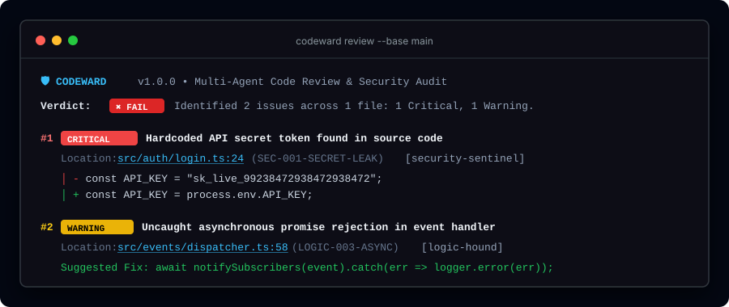

<p align="center">
  <pre align="center">
  ██████╗ ██████╗ ██████╗ ███████╗██╗    ██╗ █████╗ ██████╗ ██████╗ 
 ██╔════╝██╔═══██╗██╔══██╗██╔════╝██║    ██║██╔══██╗██╔══██╗██╔══██╗
 ██║     ██║   ██║██║  ██║█████╗  ██║ █╗ ██║███████║██████╔╝██║  ██║
 ██║     ██║   ██║██║  ██║██╔══╝  ██║███╗██║██╔══██║██╔══██╗██║  ██║
 ╚██████╗╚██████╔╝██████╔╝███████╗╚███╔███╔╝██║  ██║██║  ██║██████╔╝
  ╚═════╝ ╚═════╝ ╚═════╝ ╚══════╝ ╚══╝╚══╝ ╚═╝  ╚═╝╚═╝  ╚═╝╚═════╝ 
  </pre>
</p>

<p align="center">
  <b>Multi-Agent AI Code Reviews & Security Audits for Git Diffs and Pull Requests</b>
</p>

<p align="center">
  <a href="https://nodejs.org"></a>
  <a href="./LICENSE"></a>
  <a href="https://owasp.org/www-project-top-ten/"></a>
  <a href="https://www.typescriptlang.org"></a>
</p>

---

## ⚡ Overview

**Codeward** is a fast, modular CLI tool and GitHub Action that performs multi-agent code reviews and automated security audits on your Git diffs.

Instead of relying on a single generic prompt, Codeward deploys a team of **specialized AI personas** in parallel:
- 🛡️ **Security Sentinel**: Hunt down exposed secrets, SQL/command injection, IDOR, SSRF, XSS, and OWASP Top 10 vulnerabilities.
- ⚡ **Logic & Reliability Hound**: Uncover edge cases, unhandled promises, race conditions, null dereferences, and boundary regressions.
- 🚀 **Performance & Architecture Critic**: Diagnose N+1 query patterns, memory leaks, unnecessary re-renders, and breaking API contracts.

All findings pass through an intelligent **Synthesis & Deduplication Engine** that eliminates noise, aggregates cross-agent insights, ranks by severity (`CRITICAL`, `WARNING`, `SUGGESTION`), and outputs actionable fixes directly to your terminal or PR comments.

---

## 🎥 Demo

<p align="center">
  
  <br />
  <em>Illustration of the terminal report format.</em>
</p>

---

## 🏗️ Architecture

```
                           ┌─────────────────────────┐
                           │        Git Diff         │
                           │  (staged / base branch) │
                           └────────────┬────────────┘
                                        │
                                        ▼
                           ┌─────────────────────────┐
                           │    Filter & Chunker     │
                           │  • Ignore lockfiles/bins│
                           │  • Smart chunk batches  │
                           └────────────┬────────────┘
                                        │
             ┌──────────────────────────┼──────────────────────────┐
             ▼                          ▼                          ▼
    ┌─────────────────┐        ┌─────────────────┐        ┌─────────────────┐
    │ Agent 1:        │        │ Agent 2:        │        │ Agent 3:        │
    │ Security        │        │ Logic &         │        │ Performance &   │
    │ Sentinel        │        │ Reliability     │        │ Architecture    │
    │ (OWASP, Secrets)│        │ (Async, Regress)│        │ (N+1, Leaks)    │
    └────────┬────────┘        └────────┬────────┘        └────────┬────────┘
             │                          │                          │
             └──────────────────────────┼──────────────────────────┘
                                        │
                                        ▼
                           ┌─────────────────────────┐
                           │  Synthesis Engine       │
                           │  • Deduplicate overlaps │
                           │  • Prioritize severity  │
                           │  • Score confidence     │
                           └────────────┬────────────┘
                                        │
             ┌──────────────────────────┼──────────────────────────┐
             ▼                          ▼                          ▼
    ┌─────────────────┐        ┌─────────────────┐        ┌─────────────────┐
    │ Terminal UI     │        │ GitHub PR       │        │ Structured JSON │
    │ (Chalk / Boxen) │        │ Markdown Report │        │ (CI Automation) │
    └─────────────────┘        └─────────────────┘        └─────────────────┘
```

---

## 🚀 Quickstart

**Install from this GitHub repository only.** The unscoped npm package named `codeward` is a different project. Do not use it to install, run, or import this project.

Build this checkout with Node.js 18.8+. Cloning source and fetching locked build dependencies normally use the network. The mock review does not contact a model provider:

```bash
git clone https://github.com/Andrew-Smith-93/codeward.git
cd codeward
npm ci --ignore-scripts
npm run build
CODEWARD_DIR="$PWD"
```

From an existing Git repository with at least one commit and a staged change, try the built CLI offline:

```bash
node "$CODEWARD_DIR/bin/codeward.js" init
node "$CODEWARD_DIR/bin/codeward.js" review --staged --provider mock --fail-on none
```

The mock provider checks local wiring only; its findings are synthetic. Configure a real provider separately only if you intend to send your selected code diffs to it.

To try a self-contained example, run this after building a checkout that contains the demo script:

```bash
bash "$CODEWARD_DIR/scripts/demo-offline.sh"
```

The demo creates and removes a temporary Git repository with one benign staged file. It does not use your current repository, provider credentials, or GitHub. To reproduce the same mock path from the original [v2.0.0 tag](https://github.com/Andrew-Smith-93/codeward/tree/v2.0.0), build that checkout and use the explicit CLI command above; the convenience script is not part of that tag.

---

## 🤖 The Review Agent Ensemble

| Agent | Specialty | What It Catches |
| :--- | :--- | :--- |
| **🛡️ Security Sentinel** | AppSec, OWASP Top 10, Auth | Hardcoded keys, SQL/NoSQL injection, Command injection, SSRF, IDOR, XSS, Path traversal, weak hashing. |
| **⚡ Logic Hound** | Correctness, Edge Cases | Unhandled promise rejections, race conditions, off-by-one loops, null dereferencing, swallowed errors. |
| **🚀 Performance Critic** | Scalability, System Architecture | N+1 queries, memory leaks, uncleaned subscriptions, O(n²) bottlenecks, breaking API changes. |

You can run all three agents (default) or select specific ones:
```bash
node "$CODEWARD_DIR/bin/codeward.js" review --staged --agents security,logic --provider mock --fail-on none
```

---

## 📋 CLI Commands & Capabilities

| Local subcommand | Behavior |
| :--- | :--- |
| `review` | Reviews a selected Git diff. The examples above select the offline mock provider explicitly. |
| `fix` | Can modify the local worktree. Inspect changes before accepting them. |
| `pr` | Can send inline comments to a GitHub pull request. It is not part of the offline Action. |
| `watch` | Repeats local review on changes. A configured remote provider receives the selected diffs. |

### Review Options

```
Options:
  -b, --base <branch>        Base git branch to diff against (e.g. main, origin/main)
  -s, --staged               Review only staged changes (git diff --cached)
  -u, --unstaged             Review unstaged working tree changes
  -p, --provider <provider>  LLM provider: openai, anthropic, gemini, ollama, mock
  -m, --model <model>        Override default model for the selected provider
  --api-key <key>            Provider API key (defaults to env var)
  --api-url <url>            Custom API base URL (OpenAI-compatible / proxies)
  -f, --format <format>      Output format: terminal, markdown, json, sarif, html
  -o, --output <file>        Save output report to file
  --html <file>              Export interactive standalone HTML report
  --fail-on <severity>       Exit with code 1: critical, warning, suggestion, none (default: "critical")
  -a, --agents <agents>      Comma-separated agents: security, logic, performance
  --pr                       Shortcut for GitHub PR Markdown format
  --fix                      Auto-patch code after reviewing
  --verify-critical          Second-opinion verifier to eliminate false alarms
  --exclude <patterns>       Comma-separated file patterns to ignore
```

---

## Programmatic API

For source-based development, see the [exports in this repository](./src/index.ts). The npm package with the same unscoped name is not this project's API.

## GitHub Action: offline smoke check only

Version 2 removes the legacy Action's provider, credential, and PR comment inputs. It only checks local wiring on a Git diff with mock findings. The review step does not contact an LLM, post comments, edit source, or certify the code as secure. GitHub checkout, runner setup, and locked dependency installation can still use the network before the mock review starts. Do not enable the v1.0.0 Action with credentials.

For a GitHub Actions setup, use the source checked out by [this repository's read-only smoke workflow](./.github/workflows/review.yml), or pin this project to a reviewed version 2 release. Check out with full history, turn off checkout credential persistence, and grant only `contents: read`. The Action's only input is an existing remote-tracking base branch (default `origin/main`).

`init` only creates an offline config. It does not set up GitHub Actions, replace existing configs, or edit existing workflows. The optional `hook` command creates an offline smoke hook tied to the current local CLI and does not replace an existing hook. Neither command uses the unscoped npm package.

## Offline configuration

You can configure a new repository manually with a `.codewardrc.json` file, if you do not already have a config:

```json
{
  "$schema": "https://raw.githubusercontent.com/Andrew-Smith-93/codeward/e08724f9ff4f9922099651117ff74bb1872e480c/schema.json",
  "provider": "mock",
  "failOn": "none"
}
```

---

## 🔒 Built-in Ignore Rules

Codeward automatically filters out non-reviewable files before sending diffs to LLMs:
- **Lockfiles**: `package-lock.json`, `pnpm-lock.yaml`, `yarn.lock`, `cargo.lock`, `poetry.lock`, etc.
- **Minified Bundles**: `*.min.js`, `*.min.css`, `*.bundle.js`, `*.chunk.js`.
- **Binaries & Media**: Images (`.png`, `.jpg`, `.svg`), fonts (`.woff2`), archives (`.zip`), compiled code (`.wasm`, `.pyc`).
- **Build Directories**: `dist/`, `build/`, `.next/`, `coverage/`.

---

## 🛠️ Local Development & Testing

```bash
# Clone the repository
git clone https://github.com/Andrew-Smith-93/codeward.git
cd codeward

# Install dependencies
npm ci --ignore-scripts

# Run unit tests
npm test

# Build TypeScript
npm run build

# Run local CLI binary
node ./bin/codeward.js review --provider mock --staged --fail-on none
```

---

## 📄 License

[MIT](./LICENSE) © Codeward Contributors
